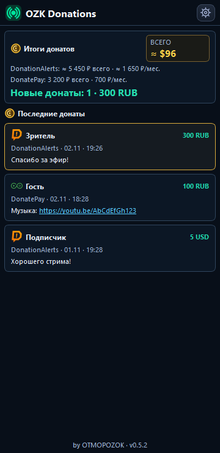
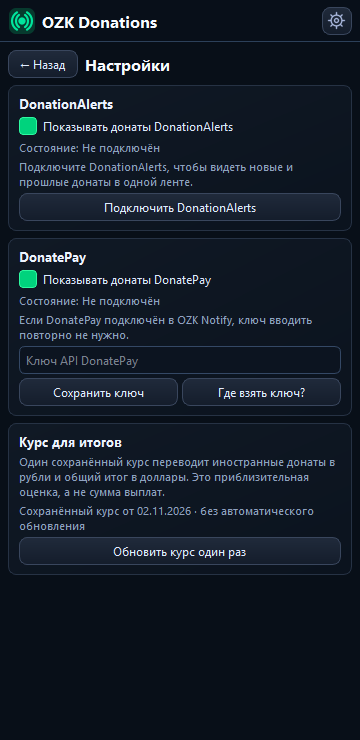
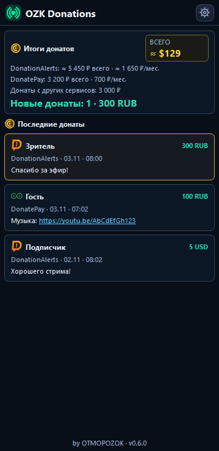
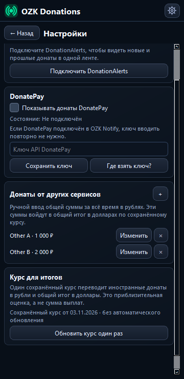

# OZK Donations for OBS

**Версия 0.6.6:** при совместной работе с OZK Notify новые донаты DonationAlerts приходят через него, без второго подключения. Если Notify выключен, Donations подключается самостоятельно. При ограничении запросов DonatePay загрузка старой истории делает более длинную паузу.

Версия 0.6.3: шапка выровнена с OZK Notify; снижена работа в потоке интерфейса OBS; добавлена запись заметных задержек в журнал для проверки отзывчивости.

**Версия 0.6.2:** DonatePay запускается независимо от переподключений DonationAlerts. Если установлен OZK Notify 1.0.19 или новее с тем же аккаунтом DonatePay, имя, сумма и текст передаются в ленту сразу после получения Notify, без ожидания повторного запроса. Один донат учитывается один раз. Donations по-прежнему работает отдельно; история, кеш и ручные суммы сохраняются.

Отдельная док-панель OBS для донатов из **DonationAlerts** и **DonatePay**. Показывает имя, сумму, время, сервис и текст сообщения. Можно использовать один сервис или оба сразу.

Панель оформлена в цветах OZK StreamKit. Жёлтые значки выделяют итоги и список донатов, а общий примерный итог в долларах помещён в отдельный небольшой блок. Когда аккаунт уже подключён, на главной странице сразу открывается лента донатов: карточек подключения там нет. Подключение и выбор сервисов находятся в шестерёнке.

## Как выглядит

Снимки настоящего интерфейса с демонстрационными данными.

| Лента донатов | Настройки подключений и курса |
| --- | --- |
|  |  |

[Узкая панель](docs/screenshots/home-300.png) · [Нижняя часть настроек](docs/screenshots/settings-bottom-360.png)

## Донаты от других сервисов — ручной ввод

В настройках откройте **«Донаты от других сервисов»** и нажмите **+**. Укажите название сервиса и полученную сумму за всё время в рублях. Для каждого дополнительного сервиса добавьте отдельную запись. Записи можно изменить или удалить; они сохраняются на вашем компьютере.

На главной странице появится одна строка **«Донаты с других сервисов: … ₽»**, без перечисления названий. Эта сумма добавляется к общему приблизительному итогу в долларах по сохранённому курсу. Она не считается новым донатом и не входит в сумму за месяц. Интернет для ручного ввода не требуется.

| Общая сумма на главной | Ручные сервисы в настройках |
| --- | --- |
|  |  |

[Окно добавления сервиса](docs/screenshots/manual-add-dialog.png). Снимки сделаны с демонстрационными данными.

## Музыкальные заказы и клипы YouTube

Ссылки YouTube и youtu.be в сообщениях доната можно нажать прямо в ленте. Видео откроется внутри OZK Donations. После окончания ролика панель сама вернётся к списку; кнопка «К донатам» позволяет вернуться раньше. Браузерный компонент OBS включается только на время просмотра.

Некоторые авторы запрещают встроенный просмотр своих видео, а YouTube иногда просит подтвердить вход. Тогда используйте кнопку «Открыть на YouTube». Звук попадёт к зрителям, если в OBS включён захват того устройства, на котором воспроизводится плеер, например «Звук рабочего стола».

## Подключение

Если вы уже вошли в DonationAlerts или добавили ключ DonatePay в **OZK Notify** под той же учётной записью Windows, OZK Donations подхватит доступ автоматически. Для новых донатов повторный вход не нужен. OZK Notify можно использовать отдельно: OZK Donations умеет работать и без него.

Вход OZK Notify разрешает получать **новые** донаты DonationAlerts, но не читать старые. Чтобы добавить прошлые донаты в список, один раз откройте шестерёнку OZK Donations, нажмите **«Разрешить историю DonationAlerts»** и подтвердите дополнительный доступ в браузере. Это не меняет вход и настройки OZK Notify. Без такого разрешения новые донаты DonationAlerts продолжат приходить.

Если OZK Notify нет, откройте шестерёнку в OZK Donations:

1. Для DonationAlerts нажмите «Войти в DonationAlerts» и подтвердите доступ в браузере.
2. Для DonatePay [создайте ключ API в личном кабинете](https://donatepay.ru/page/api), вставьте его в поле и нажмите «Сохранить ключ».
3. Оставьте включённым один или оба сервиса по своему выбору.

Ключи сохраняются в зашифрованном виде средствами Windows только на этом компьютере. OZK Donations читает настройки OZK Notify, но не изменяет их.

## Как установить

Поддерживается Windows x64 и OBS Studio 33. Скачайте архив **OZK-Donations-0.6.6-OBS33-Windows-x64** на странице [сборки Windows](https://github.com/DIMI0007/ozk-donations/actions/workflows/build-only-windows.yml), скопируйте папку `ozk-donations` из архива в `C:\ProgramData\obs-studio\plugins\`. Затем откройте OBS: панель появится в меню «Док-панели» → «OZK Donations». Если OBS открыт, закройте его до копирования файлов.

Обе службы работают независимо. OZK Notify для работы этой панели не обязателен.

## Что отображается

- DonationAlerts: новые донаты после подключения панели и последние донаты из истории, если разрешён просмотр истории.
- DonatePay: последние подтверждённые донаты и обновления во время работы OBS.
- В верхнем блоке для каждого сервиса отдельно показаны общий итог и сумма за текущий календарный месяц в рублях. Справа — общая сумма подключённых сервисов примерно в долларах за всё время. Если донаты были в другой валюте, плагин переводит их по одному сохранённому курсу; поэтому пересчитанные суммы помечены «≈». Дата курса и кнопка его ручного обновления находятся в настройках; исходные суммы по валютам — в подсказке при наведении. Это оценка по единому курсу, а не фактическая сумма выплат или пересчёт по курсу каждого дня.

  Курс запрашивается один раз при первом запуске и сохраняется на компьютере без автоматического обновления. Пока своего снимка нет, панель может использовать сохранённые курсы OZK Notify. Если нужного курса нет, неполная сумма не выдаётся за общий итог. История донатов загружается постепенно; готовые итоги сохраняются в зашифрованном кеше и появляются сразу при следующем запуске OBS. Сама лента хранит 100 последних записей.
- Ниже — число и сумма новых донатов за текущий запуск OBS. Старые донаты из истории в этот итог не входят.

В списке «Последние донаты» новые записи текущего запуска OBS отмечены тонким янтарным контуром. Повтор старого доната остаётся обычной записью и не увеличивает итог новых донатов.

Последние загруженные донаты обоих сервисов сохраняются в зашифрованном локальном кеше Windows. При следующем запуске OBS список появляется сразу, затем обновляется после ответа сервисов. Кеш хранит до 100 записей и доступен только под текущей учётной записью Windows. После смены ключа или аккаунта старые записи от другого входа не показываются.

Панель показывает именно донаты. Подписки, Bits и другие события сюда не добавлены без подтверждённой поддержки их API. Лента сохраняется в зашифрованном кеше на этом компьютере.

Если установлен OZK Stats 1.1.5 или новее, в его сворачиваемой секции «Наши плагины» появляется строка OZK Donations: локальная связь, отправленные и полученные данные за запуск OBS, измеренные участки работы CPU и учтённая память данных. OZK Donations продолжает работать самостоятельно без Stats.

## Поддержать проект

OZK StreamKit развивается за счёт поддержки пользователей. Если плагины полезны, [поддержите дальнейшую разработку](https://dalink.to/otmopozok).

Разработчик: [OTMOPOZOK](https://github.com/DIMI0007). Лицензия: GPL-2.0.
